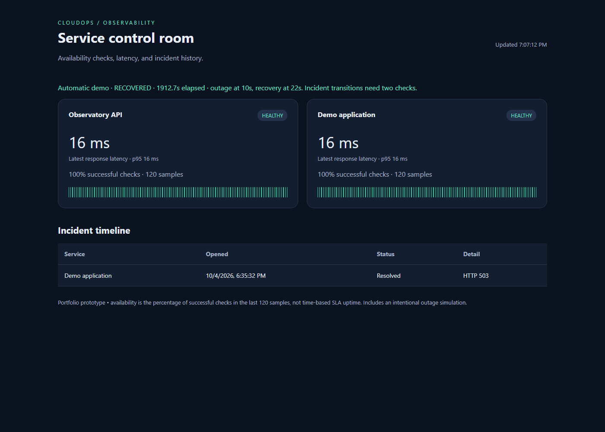

# CloudOps Observatory

A cloud operations portfolio project: monitor HTTP services, inspect response latency, and follow persistent incident history from a dashboard.

**Built by Ismet Xani** — DevOps, Cloud & Infrastructure Engineering  
New York, NY | [LinkedIn](https://www.linkedin.com/in/ismet-xani-003201395) | [GitHub](https://github.com/ismet1292-wq)

Economic Engineering graduate and LSU DevOps Engineer Certificate holder building hands-on cloud operations, infrastructure automation, containerization, CI/CD, and observability projects.



## Implemented version 0.4

Start with `py -3 app.py --demo` and open http://127.0.0.1:8080.
The demonstration automatically runs healthy → outage → recovery in about
30 seconds. It uses a separate demo.db file and requires no external service.
See [your first Python lesson](docs/PYTHON_LESSON_01.md) and lesson_01.py.

- Configured HTTP/HTTPS endpoint checks with timeout and expected status.
- Bounded concurrent probes (up to eight workers) and configurable consecutive-failure/recovery thresholds, persisted across restarts.
- SQLite check history and deduplicated incidents, automatically resolved on recovery.
- Dashboard with per-service sample availability, latency, and history.
- JSON status API and a health endpoint.
- Prometheus-compatible metrics and a nearest-rank p95 latency value in the status API.
- An intentional HTTP 503 endpoint for demonstrating outages.
- A timed local demonstration with two-failure/two-success incident thresholds.
- A short standalone Python exercise for checking one HTTP endpoint.
- Integration and state-transition tests, Docker packaging, and a GitHub Actions test workflow.
- A validated local Minikube deployment and a GitHub Actions workflow that publishes public GHCR images with latest and immutable commit-SHA tags.

This is a working local prototype, not a production platform. The Docker image, public GHCR release, Minikube deployment, non-root execution, health probes, persistent storage, pod replacement, and GitHub Actions workflows were validated. No live cloud deployment, notifications, authentication, Terraform-managed production infrastructure, load testing, or production security audit has been completed. See docs/DEPLOYMENT_RUNBOOK.md and docs/INTERVIEW_GUIDE.md.

## Start on Windows (PowerShell)

Install Python 3.12 or later if needed. Extract the folder, open PowerShell in it, then:

```powershell
py -3 app.py
```

Open http://127.0.0.1:8080. The API service should become healthy and the outage simulation should show an open incident after two monitoring cycles (roughly 15–30 seconds). Stop with Ctrl+C. If `py` is unavailable, use `python app.py`.

To demonstrate recovery, change the outage simulation URL in `services.json` to `http://127.0.0.1:8080/healthz`, retaining its service name. Restart the app with the same database. Its incident resolves after two successful checks (roughly 15–30 seconds).

```powershell
py -3 -m unittest -v
```

## Docker

```powershell
docker build -t cloudops-observatory .
docker volume create observatory-data
docker run --rm -p 127.0.0.1:8080:8080 -v observatory-data:/data cloudops-observatory
```

### Public container image

The verified image is publicly available from GitHub Container Registry:

```powershell
docker pull ghcr.io/ismet1292-wq/cloudops-observatory:latest
docker run --rm -p 127.0.0.1:8080:8080 ghcr.io/ismet1292-wq/cloudops-observatory:latest
```

Each release also receives an immutable Git commit-SHA tag for traceability.

Configure only endpoints you own or have permission to monitor. Configuration is read at startup. In Docker, localhost refers to this container; adjust URLs when monitoring other services.

## Architecture and decisions

Browser → read-only HTTP API → SQLite. A background worker probes trusted configured services and writes check results and incident transitions. A failed check opens one incident per service; a successful check resolves it. The demo opens an incident after two consecutive failures and resolves it after two consecutive successes. Every probe result still counts toward sample availability.

The initial version uses Python's standard library so installation is simple. SQLite is adequate for one local process. Probes run concurrently with at most eight worker threads; larger service lists are queued. A cycle completes when its probes finish, so its slowest probe still affects the next cycle start. Availability is calculated over the latest 120 checks, not elapsed time. The worker waits the configured interval after each full cycle.

## Planned advanced releases — not implemented

1. Retention, structured logs, stale-data detection, and richer Prometheus metrics.
2. PostgreSQL, authenticated administration, separate scheduler/workers, and audit records.
3. Notification delivery with retry queues, incident acknowledgement, and maintenance windows.
4. Terraform deployment to AWS, least-privilege IAM, secret management, and budget controls.
5. Managed cloud deployment, Kubernetes rollback demonstrations, image signing/SBOM generation, and automated release promotion.
6. Load tests, failure-injection experiments, SLO reporting, and an operational runbook.

## Before publishing a live demo

Keep the prototype bound to localhost. Its status API exposes configured endpoint URLs and error details. The standard-library HTTP server is for local demonstration, not public production hosting. Before internet exposure add authentication, a production server/reverse proxy, TLS, SSRF controls (including redirect and DNS handling), credential redaction, rate limits, retention, and operational monitoring. No secrets should be placed in repository configuration.

## Recruiter evidence and interview preparation

Record a short demo showing healthy service → outage → incident → recovery. Include actual test output and a screenshot. Be prepared to explain the incident state machine, timeout handling, sample-based availability, SQLite transactions, Docker networking, and how you would scale the worker.

This first version was created with AI assistance. Review, run, modify, and understand it before describing it on your resume. Claim only features you have verified; do not present planned cloud infrastructure as deployed work.

## Terraform foundation (AWS)

The `terraform/` folder contains a minimal AWS provider configuration for
`us-east-1`, a read-only availability zone data source, and an output for
availability zone names. It defines no AWS resources.

Completed checks:
- `terraform init` downloaded the provider and created the dependency lock file.
- `terraform validate` passed.
- `terraform fmt` completed.

No AWS lookup or deployment has been run. No credentials were created.
Running the availability zone lookup would require existing AWS credentials;
local validation does not.

AWS deployment remains planned work.

### Automated Terraform checks

The `Validate Terraform` GitHub Actions workflow checks formatting,
initializes providers with the backend disabled, and validates configuration.
It runs when Terraform files or its workflow change, and supports manual runs.

The first run passed for commit `c8b9d43`.
These checks require no AWS credentials and do not deploy resources.

See [the proposed AWS deployment plan](docs/AWS_DEPLOYMENT_PLAN.md) for architecture, persistence, cost decisions, and deployment verification. This is planning only; AWS deployment remains unfinished.

Deployment drafts now live in `infrastructure/aws-network/` and
`infrastructure/aws-host/`. They define the proposed network, EC2 host,
Systems Manager role, encrypted disks, and container startup service.
They have not been deployed; cloud startup and recovery remain unverified.
