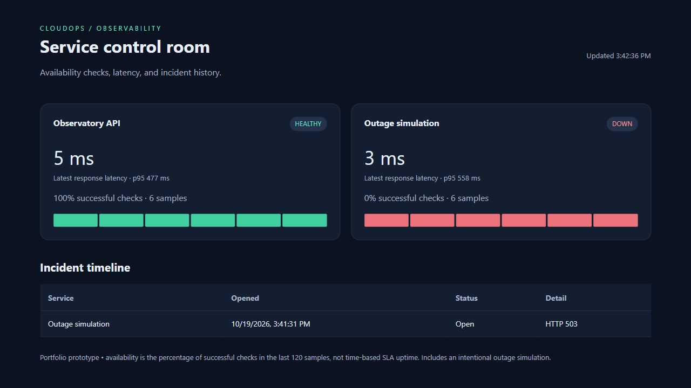

# AWS demonstration results - October 19, 2026

A temporary Terraform-managed AWS demonstration completed successfully in
us-east-1. The host and both disks were deleted afterward; the network remains.
This is a verified single-host demonstration, not a production deployment.

## Environment and access

- Amazon Linux 2023 x86-64, AMI ami-0856027a77429315a, verified as Amazon-owned.
- One t3.micro, standard CPU credits, IMDSv2 required with hop limit one.
- Encrypted gp3 disks: 12 GiB root and 8 GiB application data.
- Security group: no inbound rules; outbound TCP 443 only.
- Dashboard bound to 127.0.0.1:8080 and accessed through an SSM tunnel.
- Non-root container, read-only root filesystem, dropped capabilities and bounded logs.
- Public linux/amd64 image from source commit dd87b9caa69998c30adb9f24c8eb788a7f6ee37e:

```text
ghcr.io/ismet1292-wq/cloudops-observatory@sha256:6a0e30e4179b1f23eda23d52f73b57a0d61f4643510fa6ab6796bfabe8cbf417
```

## Observed results

- Initial cloud-init/bootstrap completed in approximately 331 seconds.
- Both EC2 status checks passed; SSM reported Online.
- Health endpoint returned status ok; dashboard and metrics responded over the tunnel.
- The default timed demonstration captured healthy, outage, and recovered phases
  at approximately 6.3, 17.6, and 30.5 seconds. One incident opened during the
  outage and the same incident resolved after recovery.
- Restarting the systemd service replaced the container and preserved demo incidents.
- A real host reboot was issued at 19:46:59 UTC. At 19:48:17 UTC, the app was
  healthy again automatically. The baseline incident and prior check history
  for both services were preserved on the mounted data disk.

[Runtime evidence](evidence/aws-cloud-validation.json),
[reboot verification](evidence/aws-reboot-verification.json), and
[cleanup verification](evidence/aws-cleanup-verification.json) record the results.



## Cleanup and cost boundary

The user approved a demonstration of up to one hour with a $1 allowance,
followed by deletion of the demo host and test disks. This allowance was an
operating instruction, not an AWS-enforced spending cap.

The instance launched at 19:35:24 UTC and was terminated during cleanup about
15 minutes later. Terraform removed all six host-root resources, including the
data disk, instance role, policy attachment, and instance profile. AWS confirmed
both the root and data disk IDs absent; the host Terraform state is empty.
Data-disk prevent_destroy protection was restored in source after the approved
deletion. No snapshot was requested or created by the configuration.

The separate VPC, subnet, security group, internet gateway and routing foundation
remain. No running dashboard or retained application disk remains from this test.
Runtime, disk, and public IPv4 usage may consume credits or create charges;
actual billing and credit application were not verified. No zero-cost claim is made.

## Limits and repeatability

This tested internal demonstration endpoints on one host. Host replacement,
external production monitoring, load testing, notifications, authentication,
and a production security audit were not established by this exercise.
Local state and account-specific inputs are ignored by Git and must be retained
securely. Recheck image/AMI availability and review costs before another apply.
The data initialization option requires explicit approval for a new blank disk.
